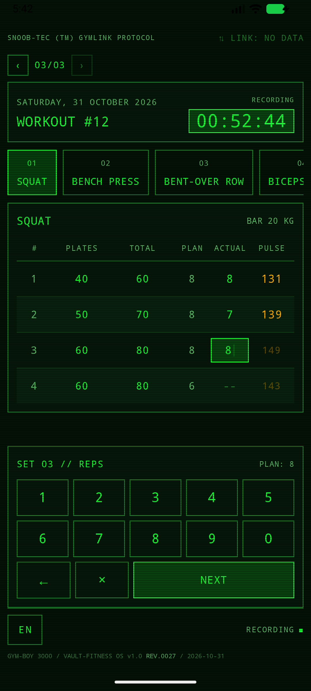
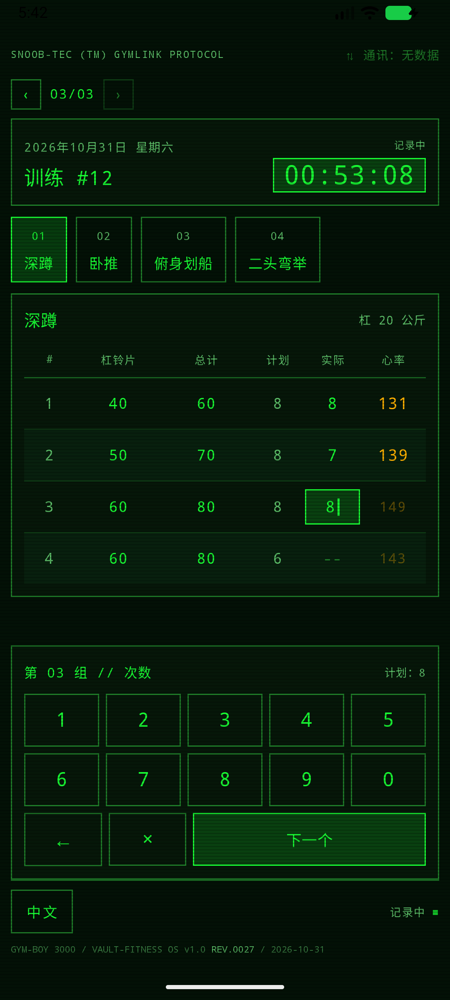
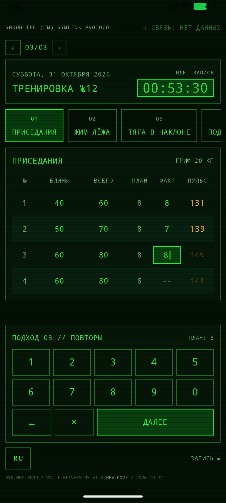

# Gym-Boy 3000

| English | 中文 | Русский |
|---------|------|---------|
|  |  |  |
| [English](#english) | [中文](#中文) | [Русский](#русский) |

Retro-terminal gym workout logger for Android.

Documentation is maintained in three languages, in this order: **English → 中文 → Русский**.

## English

Personal Android app for logging gym workouts. The style is the Pip-Boy from Fallout: a phosphor-green terminal, a monospaced font, panel frames, CRT scanlines.

### Download

Signed APK: [Releases](https://github.com/sneeb123/gym-boy-3000/releases/latest) — download the APK, allow installing from unknown sources (the app is free, MIT-licensed; releases are published in this repository, the source code is developed in a private one). Updates install from inside the app: once a day it quietly checks the latest release here (anonymously, works without cloud sign-in), downloads the APK with a sha256 check and hands it to the system installer; the current revision is visible in the footer as `REV.NNNN`.

### Concept

The workout program is composed **not** on the phone: it is generated externally (a neural network / script / chat-bot) as a JSON file and delivered to the phone over automatic sync with a private GitHub repository (see «Cloud» below). During a workout you fill in only two fields: **actual reps** and **pulse**. The result goes to the cloud by itself and is analyzed externally — the next program is composed from it. A closed loop.

### Workout screen

- **Header**: date, workout number, **START** button. On press it turns into a stopwatch; pressing again records the workout time.
- **Paging through workouts**: swipe or the `‹ 02/06 ›` arrows at the top switch between records chronologically — finished workouts from `results/` (read-only, marked `// ARCHIVE`), then the active workout (editable), then planned future workouts (marked `// PLAN`). On launch the nearest unfinished workout opens; **START** is available on any plan page, and plan pages show the last workout's pulse for the same exercise as an amber hint.
- **Language**: the button in the footer cycles English → 中文 → Русский (English is the default; the choice is remembered on the phone).
- **Exercise tabs** with a sets table:

| # | PLATES | TOTAL | PLAN | ACTUAL | PULSE |
|---|--------|-------|------|--------|-------|
| 1 | 40     | 60    | 8    | 8      | 125   |
| 2 | 50     | 70    | 8    | 7      | 138   |

Only ACTUAL and PULSE are editable, with the built-in keypad instead of the system keyboard — the sets table stays fully visible; a tap on ACTUAL prefills the planned value as a draft, `NEXT` walks through sets and pulse, and the panel closes itself after the last set. «Plates» is the weight of the discs on the bar, «Total» = plates + bar (the bar weight is set per exercise, 20 kg by default).

### Data formats

#### Program (input, `gymboy-program/1`)

Everything except `actual_reps`/`pulse` is filled in externally. Optional fields can be omitted.

```json
{
  "schema": "gymboy-program/1",
  "workout_number": 42,
  "date": "2026-10-23",
  "notes": "Leg focus, 3 min rest between sets",
  "exercises": [
    {
      "name": "Squat",
      "bar_weight_kg": 20.0,
      "sets": [
        { "plates_weight_kg": 40.0, "planned_reps": 8 },
        { "plates_weight_kg": 50.0, "planned_reps": 8 },
        { "plates_weight_kg": 60.0, "planned_reps": 8 },
        { "plates_weight_kg": 60.0, "planned_reps": 6 }
      ]
    }
  ]
}
```

#### Result (output, `gymboy-result/1`)

The same plus timing and actual values:

```json
{
  "schema": "gymboy-result/1",
  "workout_number": 42,
  "date": "2026-10-23",
  "started_at": "2026-10-23T18:03:11.240Z",
  "finished_at": "2026-10-23T19:07:45.110Z",
  "duration_seconds": 3873,
  "exercises": [
    {
      "name": "Squat",
      "bar_weight_kg": 20.0,
      "sets": [
        {
          "set_number": 1,
          "plates_weight_kg": 40.0,
          "total_weight_kg": 60.0,
          "planned_reps": 8,
          "actual_reps": 8,
          "pulse": 125
        }
      ]
    }
  ]
}
```

### Storage on the phone

The app's private folder (`files/`):

- `programs/` — imported programs (as is)
- `results/` — results archive, `result-<number>-<date>.json`
- `active_result.json` — the current workout, auto-saved on every input

Data leaves the phone through the cloud: handing off a workout uploads the result to `results/`, and the whole archive comes back by itself after a reinstall or on a new phone.

### Cloud (GitHub)

A closed loop without manual file shuffling: a private GitHub repository acts as a mailbox between the PC (which composes programs) and the phone.

```
programs/pending/    ← new programs (put there by the PC/neural network)
programs/imported/   ← accepted programs (moved by the app itself)
results/             ← results archive (uploaded by the app)
```

Behavior:

- The exchange runs on every return to the app from the background (at most once per 3 minutes), right after a workout is handed off to the cloud, and manually — by pull-down on the main screen (bypasses the throttle) or the «Sync» button in the comm terminal (tap the «⇅ LINK» badge in the header).
- All new programs from `pending` join the plan as a queue, nearest first; the taken files are moved to `imported`.
- During a workout (timer running) a new program is **not** applied — the files wait in `pending` for the next exchange.
- A finished workout is uploaded by the ↑ button in the paging row — the moment of hand-off is the user's decision, and the background exchange only back-fills older results. Re-uploading a file with the same content is not an error; on conflict the phone's version wins.
- The reverse path works too: results from the cloud that are missing on the phone are downloaded into the local archive — after reinstalling the app or on a new phone, the history comes back by itself at the first exchange.
- Privacy: the app checks whether the repository is private (the `private` flag) and warns if it is not — the badge shows amber «LINK: PUBLIC», the comm panel shows a warning. The exchange is not blocked: the decision is the user's.

#### Setup — quick sign-in (the main path)

The **«Sign in with GitHub»** button in the comm terminal: the app shows a code, you enter it at `github.com/login/device`, and on first sign-in GitHub also offers to install the Gym-Boy 3000 GitHub App and pick the repositories it may touch. Access is granted per repository (Contents: read/write only) — nothing else in the account is exposed. Access tokens live 8 hours; the app renews them itself with a refresh token (6 months, rotated on every renewal) — no re-sign-in unless the app stays unused for half a year.

A GitHub App token only acts where the app is installed, so it cannot create `gymboy-data` itself: create the private repository once, and pick it on the install screen (or later: Settings → Applications → Installed GitHub Apps → Configure). If the repository is not visible at sign-in, the app shows a panel with the exact steps and a RECHECK button — no second code entry needed.

#### Manual setup (PAT, if the repository already exists)

1. Create a private repository (e.g. `gymboy-cloud`) with the folders `programs/pending`, `programs/imported`, `results` (at least with `.gitkeep`).
2. Create a fine-grained token: GitHub → Settings → Developer settings → Personal access tokens → Fine-grained tokens → Generate new token; Repository access — only this repository; Permissions → Contents: Read and write.
3. In the app: tap «⇅ LINK» → «MANUAL SETUP (PAT)» → enter owner, repository and token → «Sync». The token is stored only on the phone (SharedPreferences).

#### Web editor (online)

Tabular editing of cloud files without git and JSON:
**https://sneeb123.github.io/gym-boy-3000-editor/** — a static page from the public repository [gym-boy-3000-editor](https://github.com/sneeb123/gym-boy-3000-editor). There is no server: everything runs in the browser; sign-in is a fine-grained PAT for your data repository (Contents: Read and write); the token is stored in the browser's localStorage and is sent only to api.github.com. Source — the [gym-boy-3000-editor](https://github.com/sneeb123/gym-boy-3000-editor) repository. The phone picks up the edits at the next sync.

## 中文

个人 Android 健身房训练记录应用。风格仿照《辐射》（Fallout）中的 Pip-Boy（哔哔小子）：磷光绿终端、等宽字体、面板边框、CRT 扫描线。

### 下载

签名 APK：[Releases](https://github.com/sneeb123/gym-boy-3000/releases/latest) — 下载 APK，允许"安装未知来源应用"即可（免费、MIT 许可；版本发布在本仓库，源码在私有仓库中开发）。更新从应用内安装：应用每天静默检查一次本仓库的最新 release（匿名进行，无需登录云端），下载 APK 并校验 sha256 后交给系统安装器；当前修订版号显示在页脚（`REV.NNNN`）。

### 概念

训练计划**不是**在手机上编写的：它由外部（神经网络 / 脚本 / 聊天机器人）生成为 JSON 文件，通过与私有 GitHub 仓库的自动同步送到手机（见下方「云端」）。训练时只需填写两个字段：**实际次数**和**心率**。结果会自动上传到云端，由外部进行分析——并据此编写下一个计划。闭环。

### 训练屏幕

- **页眉**：日期、训练编号、**开始**按钮。按下后变成秒表，再次按下记录训练用时。
- **记录翻页**：滑动或顶部的 `‹ 02/06 ›` 箭头按时间顺序在记录之间切换——`results/` 中已完成的训练（只读，标有 `// 存档`），然后是当前训练（可编辑），再往后是计划中的未来训练（标有 `// 计划`）。启动时打开最近的未完成训练；**开始**在计划任一页都可用，计划页会以琥珀色提示显示上次训练同一动作的心率。
- **语言**：页脚按钮在 English → 中文 → Русский 之间循环切换（默认英语；选择保存在手机上）。
- **动作标签页**，每组一行的表格：

| # | 杠铃片 | 总计 | 计划 | 实际 | 心率 |
|---|--------|------|------|------|------|
| 1 | 40     | 60   | 8    | 8    | 125  |
| 2 | 50     | 70   | 8    | 7    | 138  |

只有「实际」和「心率」可编辑，输入用的是内置数字面板而非系统键盘——组表始终完整可见；点击「实际」会以草稿代入计划值，「下一个」按组推进并转到心率，最后一组后面板自动关闭。「杠铃片」是杠铃上配重片的重量，「总计」= 杠铃片 + 杆重（杆重在动作级别设置，默认 20 公斤）。

### 数据格式

#### 计划（输入，`gymboy-program/1`）

除 `actual_reps`/`pulse` 外的所有字段都在外部填写，可选字段可以省略。

```json
{
  "schema": "gymboy-program/1",
  "workout_number": 42,
  "date": "2026-10-23",
  "notes": "腿部重点，组间休息 3 分钟",
  "exercises": [
    {
      "name": "深蹲",
      "bar_weight_kg": 20.0,
      "sets": [
        { "plates_weight_kg": 40.0, "planned_reps": 8 },
        { "plates_weight_kg": 50.0, "planned_reps": 8 },
        { "plates_weight_kg": 60.0, "planned_reps": 8 },
        { "plates_weight_kg": 60.0, "planned_reps": 6 }
      ]
    }
  ]
}
```

#### 结果（输出，`gymboy-result/1`）

同样内容再加上时间和实际值：

```json
{
  "schema": "gymboy-result/1",
  "workout_number": 42,
  "date": "2026-10-23",
  "started_at": "2026-10-23T18:03:11.240Z",
  "finished_at": "2026-10-23T19:07:45.110Z",
  "duration_seconds": 3873,
  "exercises": [
    {
      "name": "深蹲",
      "bar_weight_kg": 20.0,
      "sets": [
        {
          "set_number": 1,
          "plates_weight_kg": 40.0,
          "total_weight_kg": 60.0,
          "planned_reps": 8,
          "actual_reps": 8,
          "pulse": 125
        }
      ]
    }
  ]
}
```

### 手机上的存储

应用私有目录（`files/`）：

- `programs/` — 已导入的计划（原样保存）
- `results/` — 结果存档，`result-<编号>-<日期>.json`
- `active_result.json` — 当前训练，每次输入自动保存

数据通过云端离开手机：上传训练会把结果存入 `results/`，重装应用或换新手机后，整个存档会在第一次交换时自动恢复。

### 云端（GitHub）

无需手动搬运文件的闭环：一个私有 GitHub 仓库充当电脑（编写计划的一方）与手机之间的邮箱。

```
programs/pending/    ← 新计划（由电脑/神经网络放入）
programs/imported/   ← 已接受的计划（应用自动移入）
results/             ← 结果存档（应用上传）
```

行为：

- 交换在每次从后台返回应用时触发（最多每 3 分钟一次）、训练结果上传后立即触发，也可手动触发——主屏幕下拉（不受节流限制）或通讯终端中的「同步」按钮（点击页眉的「⇅ 通讯」指示器）。
- `pending` 中的所有新计划按队列进入计划（最近的在前）；取走的文件移入 `imported`。
- 训练期间（计时器运行中）新计划**不会**被应用——文件在 `pending` 中等待下一次交换。
- 完成的训练由翻页行中的 ↑ 按钮上传——上传时机由用户决定，后台交换只补传更早的结果。重复上传内容相同的文件不算错误；冲突时以手机版本为准。
- 反方向同样可用：云端有而手机没有的结果会下载到本地存档——重装应用或换新手机后，历史记录会在第一次交换时自动恢复。
- 隐私：应用会检查仓库是否为私有（`private` 标志），若不是则发出提醒——指示器显示琥珀色「通讯：公开」，通讯面板显示警告。此时交换不会被阻止：决定权在用户。

#### 设置——快速登录（主要方式）

通讯终端中的**「通过 GitHub 登录」**按钮：应用显示一个代码，你在 `github.com/login/device` 输入它；首次登录时 GitHub 还会提示安装 Gym-Boy 3000 GitHub App 并选择允许访问的仓库。权限按仓库授予（仅 Contents 读写），账号的其余部分保持封闭。access token 有效期 8 小时，应用通过 refresh token（6 个月，每次续期都轮换）自行静默续期——除非连续半年未使用，否则无需重新登录。

GitHub App 的令牌只在应用安装到的仓库上生效，因此应用无法自行创建 `gymboy-data`：请先创建私有仓库，并在安装界面勾选它（之后可在 Settings → Applications → Installed GitHub Apps → Configure 中添加）。如果登录时仓库不可见，应用会显示带具体步骤和「重新检查」按钮的指引面板，无需再次输入代码。

#### 手动设置（PAT，若仓库已存在）

1. 创建私有仓库（例如 `gymboy-cloud`），包含 `programs/pending`、`programs/imported`、`results` 文件夹（至少有 `.gitkeep`）。
2. 创建细粒度令牌：GitHub → Settings → Developer settings → Personal access tokens → Fine-grained tokens → Generate new token；Repository access——仅此仓库；Permissions → Contents：Read and write。
3. 在应用中：点击「⇅ 通讯」→「手动设置 (PAT)」→ 填写所有者、仓库和令牌 →「同步」。令牌只保存在手机上（SharedPreferences）。

#### 网页编辑器（在线）

无需 git 和 JSON，以表格方式编辑云端文件：
**https://sneeb123.github.io/gym-boy-3000-editor/** ——来自公开仓库 [gym-boy-3000-editor](https://github.com/sneeb123/gym-boy-3000-editor) 的静态页面。没有服务器：一切都在浏览器中运行；登录使用针对自己数据仓库的细粒度 PAT（Contents：Read and write）；令牌保存在浏览器 localStorage 中，且只发送到 api.github.com。源码——[gym-boy-3000-editor](https://github.com/sneeb123/gym-boy-3000-editor) 仓库。手机会在下一次同步时获取修改。

## Русский

Персональное Android-приложение для записи тренировок в спортзале. Стиль — Пип-Бой из Fallout:
фосфорно-зелёный терминал, моноширинный шрифт, рамки-панели, развёртка ЭЛТ.

### Установка

Подписанный APK: [Releases](https://github.com/sneeb123/gym-boy-3000/releases/latest) —
скачать APK, разрешить установку из неизвестных источников
(приложение бесплатное, лицензия MIT; релизы публикуются в этом репозитории,
исходники разрабатываются в приватном). Обновления ставятся из самого приложения:
раз в сутки оно тихо проверяет свежий релиз этого репозитория (анонимно, работает
и без входа в облако), скачивает APK с проверкой sha256 и отдаёт системному
установщику; текущая ревизия видна в футере (`REV.NNNN`).

### Концепция

Программу тренировки составляет **не** телефон: снаружи (нейросеть/скрипт/чат-бот) генерируется
JSON-файл программы и попадает на телефон по автосинхронизации с приватным репозиторием
GitHub (раздел «Облако» ниже). На тренировке заполняются только два поля: **фактические повторы** и **пульс**.
Результат уходит в облако сам и анализируется снаружи — по нему составляется следующая
программа. Замкнутый цикл.

### Экран тренировки

- **Шапка**: дата, номер тренировки, кнопка **СТАРТ**. По нажатию превращается в секундомер,
  повторное нажатие фиксирует время тренировки.
- **Листание тренировок**: свайп или стрелки `‹ 02/06 ›` вверху экрана переключают записи
  в хронологическом порядке — архив завершённых из `results/` (режим чтения, помечены
  `// АРХИВ`), затем активная тренировка (редактируемая), затем запланированные будущие
  (помечены `// ПЛАН`). При запуске открывается ближайшая невыполненная; **СТАРТ** доступен
  на любой странице плана, а страницы плана янтарной подсказкой показывают пульс того же
  упражнения с прошлой тренировки.
- **Язык**: кнопка в футере переключает English → 中文 → Русский по кругу (по умолчанию
  английский; выбор запоминается на телефоне).
- **Вкладки упражнений** с таблицей подходов:

| № | БЛИНЫ | ВСЕГО | ПЛАН | ФАКТ | ПУЛЬС |
|---|-------|-------|------|------|-------|
| 1 | 40    | 60    | 8    | 8    | 125   |
| 2 | 50    | 70    | 8    | 7    | 138   |

Редактируются только ФАКТ и ПУЛЬС — встроенной цифровой панелью вместо системной
клавиатуры (таблица подходов остаётся видимой целиком): тап по ФАКТ подставляет плановое
значение черновиком, «ДАЛЕЕ» ведёт по подходам и пульсу, после последнего подхода панель
закрывается сама. «Блины» — вес дисков на штанге, «Всего» = блины + гриф
(вес грифа задаётся на уровне упражнения, по умолчанию 20 кг).

### Форматы данных

#### Программа (вход, `gymboy-program/1`)

Всё, кроме `actual_reps`/`pulse`, заполняется снаружи. Необязательные поля можно опускать.

```json
{
  "schema": "gymboy-program/1",
  "workout_number": 42,
  "date": "2026-10-23",
  "notes": "Акцент на ноги, отдых между подходами 3 мин",
  "exercises": [
    {
      "name": "Приседания",
      "bar_weight_kg": 20.0,
      "sets": [
        { "plates_weight_kg": 40.0, "planned_reps": 8 },
        { "plates_weight_kg": 50.0, "planned_reps": 8 },
        { "plates_weight_kg": 60.0, "planned_reps": 8 },
        { "plates_weight_kg": 60.0, "planned_reps": 6 }
      ]
    }
  ]
}
```

#### Результат (выход, `gymboy-result/1`)

То же самое плюс время и фактические значения:

```json
{
  "schema": "gymboy-result/1",
  "workout_number": 42,
  "date": "2026-10-23",
  "started_at": "2026-10-23T18:03:11.240Z",
  "finished_at": "2026-10-23T19:07:45.110Z",
  "duration_seconds": 3873,
  "exercises": [
    {
      "name": "Приседания",
      "bar_weight_kg": 20.0,
      "sets": [
        {
          "set_number": 1,
          "plates_weight_kg": 40.0,
          "total_weight_kg": 60.0,
          "planned_reps": 8,
          "actual_reps": 8,
          "pulse": 125
        }
      ]
    }
  ]
}
```

### Хранение на телефоне

Приватная папка приложения (`files/`):

- `programs/` — импортированные программы (как есть)
- `results/` — архив результатов, `result-<номер>-<дата>.json`
- `active_result.json` — текущая тренировка, автосохранение при каждом вводе

Данные уходят из телефона через облако: передача тренировки заливает результат в
`results/`, а после переустановки или на новом телефоне весь архив возвращается сам
при первом обмене.

### Облако (GitHub)

Замкнутый цикл без ручного перекидывания файлов: приватный репозиторий GitHub работает
как почтовый ящик между ПК (кто составляет программы) и телефоном.

```
programs/pending/    ← новые программы (кладёт ПК/нейросеть)
programs/imported/   ← принятые приложением (переносит само)
results/             ← архив результатов (заливает приложение)
```

Поведение:

- Обмен запускается при каждом возврате в приложение из фона (не чаще раза
  в 3 минуты), сразу после передачи завершённой тренировки и вручную —
  пулл-внизом на главном экране (мимо троттлинга) или кнопкой «Синк»
  в терминале связи (клик по индикатору «⇅ СВЯЗЬ» в шапке).
- Из `pending` все новые программы встают в план очередью (ближайшая — первой);
  забранные файлы уезжают в `imported`.
- Во время тренировки (таймер идёт) новая программа **не** применяется — файлы
  ждут в `pending` следующего обмена.
- Завершённая тренировка ждёт кнопки ↑ в ряду листания — стрелка видна только
  на её странице (у тренировки должны стоять метки запуска и остановки), у
  архивных записей её нет: нажатие заливает результат в `results/` и переводит
  страницу в архив. Фоновый обмен докатывает только старые результаты — момент
  передачи текущей решает пользователь.
- Повторная заливка файла с тем же содержимым ошибкой не считается; при
  конфликте побеждает версия телефона.
- Обратный путь тоже работает: результаты из облака, которых нет на телефоне,
  скачиваются в локальный архив — после переустановки приложения или на новом
  телефоне история возвращается сама при первом обмене.
- Приватность: приложение проверяет, приватный ли репозиторий (флаг `private`),
  и уведомляет, если нет, — бейдж показывает янтарное «СВЯЗЬ: ПУБЛИЧНО», в панели
  связи — предупреждение. Обмен при этом не блокируется: решение за пользователем.

#### Настройка — быстрый вход (основной путь)

Кнопка **«Войти через GitHub»** в терминале связи: приложение показывает код, вы вводите
его на `github.com/login/device`, а при первом входе GitHub ещё и предлагает установить
GitHub App «Gym-Boy 3000» и выбрать репозитории, к которым он получает доступ. Права
выдаются по репозиториям и только на Contents (чтение/запись) — остальной аккаунт
остаётся закрыт. Access-токен живёт 8 часов; приложение само, без ведома пользователя,
продлевает его refresh-токеном (6 месяцев, ротация при каждом продлении) — перелогин
не нужен, разве что приложение не открывалось полгода.

Токен GitHub App действует только там, где приложение установлено, поэтому само оно
репозиторий `gymboy-data` больше не создаёт: создайте приватный репозиторий один раз
и отметьте его на экране установки (или позже: Settings → Applications → Installed
GitHub Apps → Configure). Если репозиторий при входе не виден, приложение покажет
панель с точными шагами и кнопкой «Проверить» — вводить код заново не придётся.

#### Ручная настройка (PAT, если репозиторий уже есть)

1. Создать приватный репозиторий (например, `gymboy-cloud`) с папками
   `programs/pending`, `programs/imported`, `results` (хотя бы с `.gitkeep`).
2. Создать fine-grained токен: GitHub → Settings → Developer settings →
   Personal access tokens → Fine-grained tokens → Generate new token;
   Repository access — только этот репозиторий; Permissions → Contents:
   Read and write.
3. В приложении: клик по «⇅ СВЯЗЬ» → «РУЧНАЯ НАСТРОЙКА (PAT)» → вписать владельца,
   репозиторий и токен → «Синк». Токен хранится только на телефоне (SharedPreferences).

#### Веб-редактор (онлайн)

Табличная правка файлов облака без git и JSON:
**https://sneeb123.github.io/gym-boy-3000-editor/** — статическая страница из
публичного репозитория [gym-boy-3000-editor](https://github.com/sneeb123/gym-boy-3000-editor).
Сервера нет: всё выполняется в браузере, вход — fine-grained PAT на свой репозиторий
данных (Contents: Read and write), токен хранится в localStorage браузера и уходит
только на api.github.com. Исходник — репозиторий [gym-boy-3000-editor](https://github.com/sneeb123/gym-boy-3000-editor). Правки
подхватываются телефоном при следующем синке.
